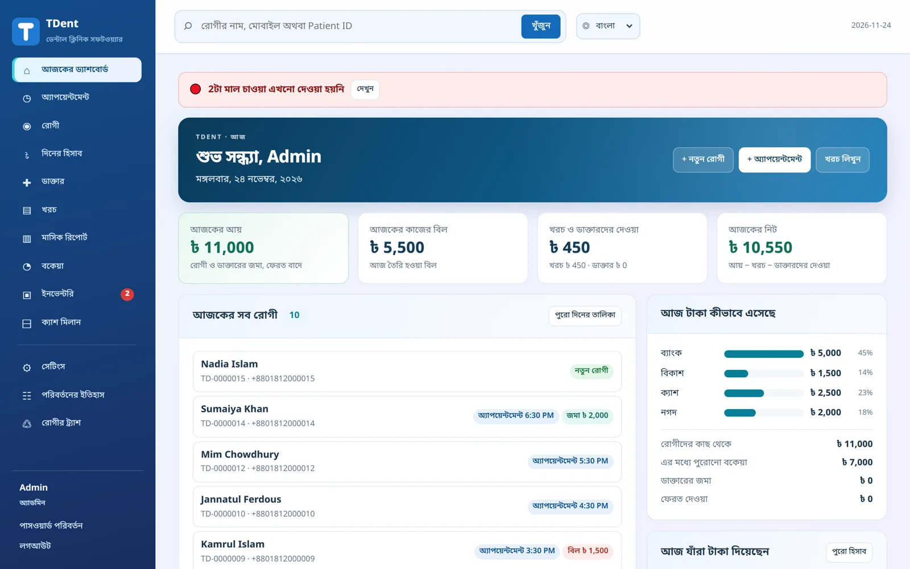

# TDent — Dental Clinic Management Software

> রোগী, বিল, ডাক্তারের হিসাব — এক জায়গায়।

এটা TDent সফটওয়্যারের প্রোডাক্ট ওয়েবসাইট। শুধু HTML, CSS আর JavaScript দিয়ে বানানো, কোনো framework বা build step লাগে না।



## সাইটে যা আছে
- প্রোমো ভিডিও (`assets/video/tdent-promo.mp4`)
- অ্যাপের ৮টা পেজের স্ক্রিনশট: ট্যাব গ্যালারি, ছবিতে চাপলে বড় করে দেখা যায়
- সব ফিচারের তালিকা
- দাম: মাসে মাত্র ৳৩০০০
- কীভাবে শুরু করবেন, প্রশ্ন-উত্তর
- WhatsApp বাটন: 01608-580002
- মোবাইল আর কম্পিউটার দুটোতেই ঠিকমতো দেখায়

## ফোল্ডারের গঠন
```
tdent-website/
├── index.html
├── style.css
├── script.js
├── README.md
└── assets/
    ├── img/     ← ৮টা স্ক্রিনশট (.webp)
    └── video/   ← প্রোমো ভিডিও + poster
```

## নিজের কম্পিউটারে দেখা
`index.html` ফাইলে ডাবল-ক্লিক করলেই ব্রাউজারে খুলবে।

## GitHub-এ দেওয়া আর GitHub Pages চালু করা
1. GitHub-এ নতুন repository বানান, যেমন `tdent`।
2. এই ফোল্ডারের সব ফাইল আপলোড করুন (**Add file → Upload files**), অথবা:
   ```bash
   git init
   git add .
   git commit -m "TDent website"
   git branch -M main
   git remote add origin https://github.com/<your-username>/tdent.git
   git push -u origin main
   ```
3. Repository → **Settings → Pages** → Source: **Deploy from a branch** → Branch: `main` / `(root)` → **Save**।
4. ১-২ মিনিট পর সাইট চালু হবে: `https://tdent.site` (custom domain, `CNAME` ফাইলে সেট করা)

## যোগাযোগ
WhatsApp: [01608-580002](https://wa.me/8801608580002)

---
Made by Tahmid
